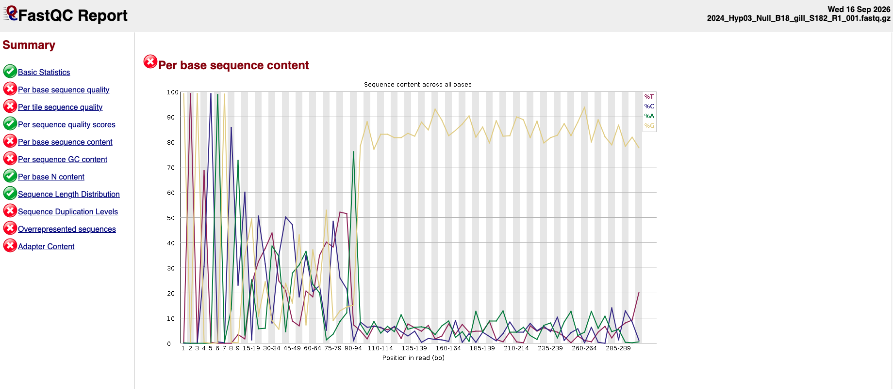

## 10.6.2026 setting up unity with R + Bionconductor
### Conda
Create environment `dada2-env` in terminal, much easier than doing it in R! 
```
conda create -n dada2-env python=3.14 
conda activate dada2-env
conda install -c conda-forge -c bioconda --strict-channel-priority r-base r-biocmanager bioconductor-dada2
conda install -c conda-forge r-tidyverse 
# install jupyter and add r kernel
pip install jupyter 
conda install -c conda-forge r-irkernel
```

### DADA2
Started running code in [jupyter notebook](dada2.ipynb) through unity interactive session with R kernel, but quickly realized that later portions would need to be run as an r script through unity because there are just so many samples! Saved edits to notebook on unity and commited those changes via command line.  
- *Note: decided to move forward with the fastp+cutadapt samples for now!*

Wrote R code following [tutorial](https://benjjneb.github.io/dada2/tutorial.html) and Caroline's [script](https://github.com/cdesouza02/BEL_16S_ITS2/blob/51f1b7652672009b21ec146c69977494d83159f5/scripts/dada2.r), and then the bash script to run on unity from Caroline's [code](https://github.com/cdesouza02/BEL_16S_ITS2/blob/main/scripts/5_dada2).
- Truncated forward and reverse read 3' end to 250bp based on the quality plots
  
  
  
  

## 10.13.26 taxonomic assignment
### Review of DADA2 outputs
Taxonomy part of r script did not work—I think it couldn't find the reference file and I didn't bother looking for it before I ran the code... It took about 2 days to run the whole code. Going back to try a different method of taxonomic assignment anyway (IDTAXA)

Reviewing the csv outputs and [slurm-dada2-65325976](slurm-dada2-65325976.out), looks like 1) there were a few samples that had serious drops between reads and merged reads I would like to investigate and 2) good to note, the removal of chimeras resulted in keeping ~90% of the reads, which may be a little high? Going to continue for now.
- For samples that had significant drop in reads, I explored the raw fastq files
  

	- After 100bp looks like the forward raw read is a string of G bases which were then trimmed in the fastp process such that the majority of sequences retained were ~20bp long, probably resulting in the inability of the quality profile to load
	- After cutadapt the majority of the sequences were 0bp long meaning that pretty much everything after the 16S primer was garbage... Interestingly, the reverse reads are totally fine! Could just be a sequencing failure

When playing around with the quality plots I found that some would fail to compile. Upon investigation, it could be because of empty reads but the only caveat is that the forward gill sample I looked at (153) renders a quality plot but has more empty reads than the forward gut sample (154)! Okay, but not going to die on this hill right now...

``` 
library(ShortRead)

fq <- readFastq("/scratch4/workspace/jade_fiorilla_student_uml_edu-rawseqorcc/fastp-cutadapt/2024_Hyp03_Null_B18_gut_S86_R1_trim.fastq")

summary(width(sread(fq)))
sum(width(sread(fq)) == 0) # nonzero output means empty reads are present
```

Could add a `-m 20` flag to cutadapt to enforce a minimum length argument.

I also compared the R script I ran with Sarah's [16S QC workflow](https://github.com/sagw/Oyster_16S/blob/f96954f2bb49a658c96a5cf0509cfb8ec54a2bad/Notebooks/QC_Runs123_combined.ipynb) I made a few edits to the script in case I want to re-run.
- Removed `trimLeft=20`
- Added line to inspect the distribution of sequence lengths

### Taxonomy two ways
Download SILVA [training sets](https://zenodo.org/records/14169026) using `wget` into work folder on unity
- Unclear if I should use the toSpecies or the toGenus set; DADA2 tutorial uses the toGenus
- Seems like the assignSpecies is a separate function that I need to install